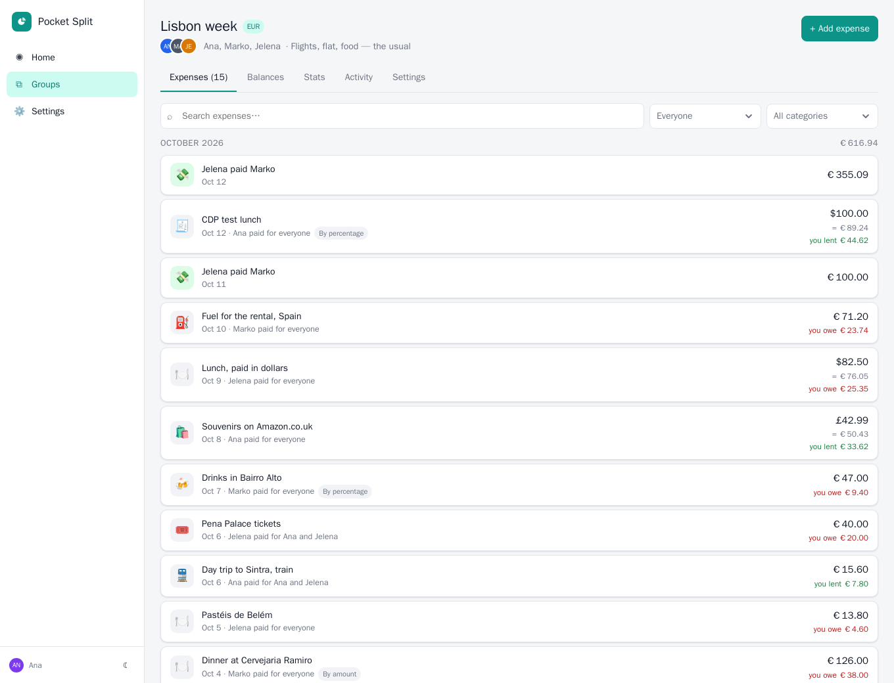
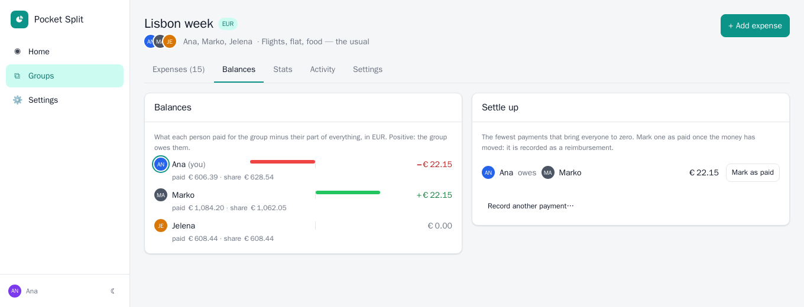
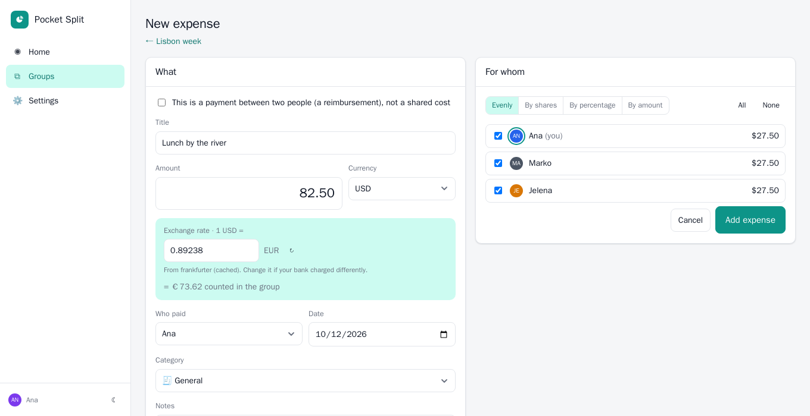
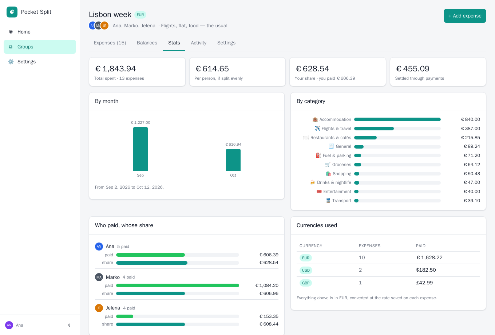
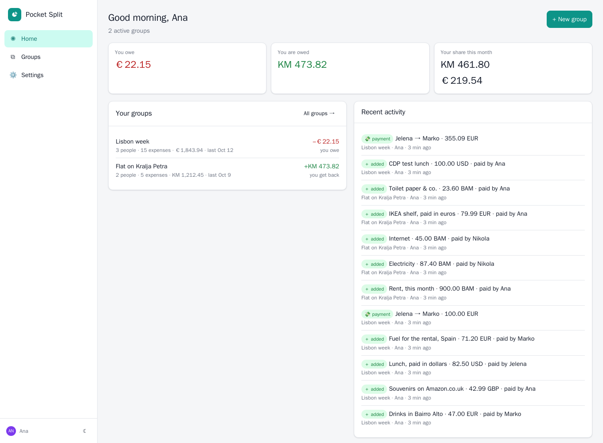
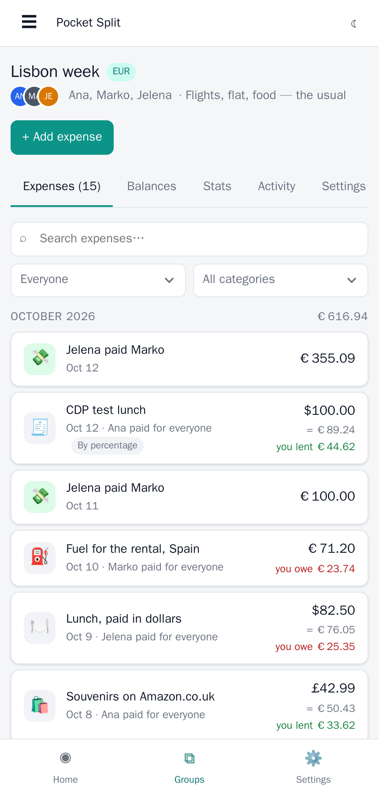
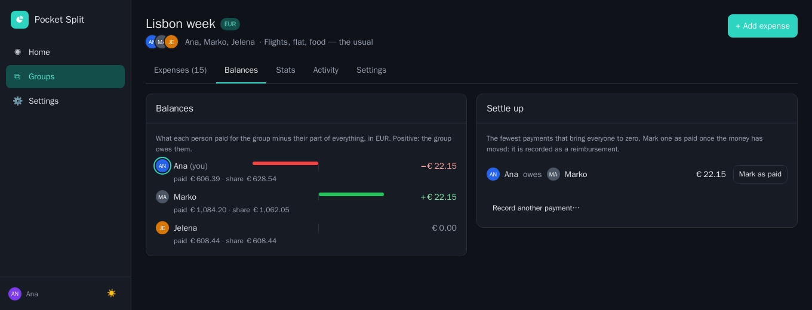

<p align="center">
  
</p>
<h1 align="center">Pocket Split</h1>
<p align="center">
  A small self-hosted cost splitter for trips, flats and dinners: who paid what, in any currency, and who owes whom.<br>
  <b>One binary · one SQLite file · one volume.</b>
</p>
<p align="center">
  <a href="https://github.com/abjelosevic88/pocket-homelab-cost-split/actions"></a>
  <a href="https://github.com/abjelosevic88/pocket-homelab-cost-split/pkgs/container/pocket-homelab-cost-split"></a>
  <a href="LICENSE"></a>
</p>

---

Splitwise wants a subscription, Spliit wants Postgres and a Vercel account. This is the same idea as a single Go binary you can run on a Raspberry Pi, built around four things:

- **A group per pot of money.** A trip, a flat, a dinner. Each group has a main currency, and every balance is counted in it. Add people by name; link the ones who have an account so they see the group and their balance.
- **Pay in any currency.** The group is in euros, the lunch was in dollars, the souvenirs in pounds. Pick the currency on the expense; the day's exchange rate is looked up (ECB via Frankfurter, ~160 currencies via ExchangeRate-API) and stored on the expense, so balances never drift. Type a different rate if your bank charged one.
- **Split it the way it happened.** Evenly, by shares (2 for the couple, 1 for the single), by percentage, or by exact amounts. The parts always add up to the cent.
- **Settle up with the fewest payments.** Balances per person, then *Jelena owes Marko 344 €*: the minimal set of transfers that brings everyone to zero. Mark one as paid and it is recorded as a reimbursement.

<p align="center"></p>

<table>
  <tr>
    <td width="50%"></td>
    <td width="50%"></td>
  </tr>
  <tr>
    <td align="center"><sub>Balances and the payments that settle them.</sub></td>
    <td align="center"><sub>An expense in dollars in a euro group, split by percentage.</sub></td>
  </tr>
  <tr>
    <td width="50%"></td>
    <td width="50%"></td>
  </tr>
  <tr>
    <td align="center"><sub>Where the money went.</sub></td>
    <td align="center"><sub>Home: your position across every group.</sub></td>
  </tr>
</table>

<p align="center">
  &nbsp;&nbsp;
  <br>
  <sub>Installable PWA with a bottom tab bar, plus dark mode.</sub>
</p>

## Features

| Area | What you get |
|---|---|
| **Groups** | Name, description, main currency (any ISO 4217 code), people with or without accounts, archive, delete. Everyone linked to the group sees it; admins see all. |
| **Expenses** | Title, amount, currency, exchange rate, who paid, date, category (14 fixed ones with icons), notes. Split evenly / by shares / by percentage / by amount. Search, filter by person or category, grouped by month with monthly totals. |
| **Currencies** | The full ISO 4217 list with correct decimals (¥ has none, BHD has three). Rates from [Frankfurter](https://frankfurter.app) (ECB, historical) with [ExchangeRate-API](https://www.exchangerate-api.com/docs/free) as fallback for the rest (BAM, RSD, …); cached per pair and day; always editable. |
| **Balances** | Paid minus share per person, in the group currency. Settle-up suggestions with the fewest payments; *Mark as paid* records a reimbursement. |
| **Stats** | Total, per head, your share, by month, by category, who paid vs whose share, which currencies were used. |
| **Home** | What you owe and are owed per currency across all groups, your share this month, recent activity. |
| **Users** | Built-in login (multi-user, admin/member), or trust your SSO proxy's header, or no login on a trusted LAN. Personal API tokens. |
| **Data** | SQLite backup from the UI/CLI/API, group export as JSON (re-importable) or CSV (one column per person), activity log per group, Prometheus `/metrics`. |

## Run it

```bash
mkdir pocket-split && cd pocket-split
curl -fsSLO https://raw.githubusercontent.com/abjelosevic88/pocket-homelab-cost-split/main/docker-compose.yml
docker compose up -d
# open http://localhost:8080 and create your account
```

Or with plain Docker:

```bash
docker run -d --name pocket-split -p 8080:8080 -v ./data:/data -e TZ=Europe/Berlin \
  ghcr.io/abjelosevic88/pocket-homelab-cost-split:latest
```

Want to look around first? Add `-e DEMO_DATA=true -e AUTH_MODE=none` to get a sample trip and a flat share with no login.

Binaries for Linux, macOS and Windows are attached to every [release](https://github.com/abjelosevic88/pocket-homelab-cost-split/releases), and a systemd unit is in [deploy/systemd](deploy/systemd).

## Configuration

Everything is an environment variable with a sensible default. The important ones:

| Variable | Default | Notes |
|---|---|---|
| `TZ` | `UTC` | Decides what "today" is for expense dates. Set it. |
| `BASE_URL` | – | Public URL (informational). |
| `DATA_DIR` | `/data` | Database and backups live here. |
| `DEFAULT_CURRENCY` | `EUR` | Offered when creating a group (also in Settings → General). |
| `FX_PROVIDER` | `auto` | `auto` (Frankfurter, then ExchangeRate-API), `frankfurter`, `erapi`, or `none` for a box without internet: rates are then typed by hand. |
| `AUTH_MODE` | `local` | `local` (built-in login, multi-user), `proxy` (trust `Remote-User` from your SSO proxy; users auto-created), `none` (single implicit user with no login, for a trusted LAN only). |
| `ADMIN_EMAIL` / `ADMIN_PASSWORD` | – | Create the first admin without the setup screen. |
| `SECURE_COOKIES` | `false` | Set `true` behind HTTPS. |
| `DEMO_DATA` | `false` | Seed a sample trip and flat share into an empty database. |

The full list is in [docs/configuration.md](docs/configuration.md), and reverse-proxy snippets are in [docs/reverse-proxy.md](docs/reverse-proxy.md).

## How the money is counted

- Amounts are stored as integer minor units (cents), never floats. A 100 € bill split three ways is 33.34 + 33.33 + 33.33, by the largest-remainder method, and it always adds up.
- An expense in another currency carries its own `fx_rate` (1 unit of its currency in the group currency). The converted amount and every person's converted part are computed once, when the expense is saved. Changing the rate later only happens if you edit that expense.
- A **reimbursement** is an expense from one person to exactly one other, left out of spending totals. Settle-up suggestions pair the largest debtor with the largest creditor until everyone is at zero; for *n* people that is at most *n − 1* payments.
- The group's main currency is locked once it has expenses (every stored part would otherwise be in the wrong unit). Create a new group instead.

## Automation

Create a token under **Settings → API tokens**, then:

```bash
# add an expense from an iOS Shortcut or n8n: 24.50 EUR, paid by member 1, split evenly between 1, 2 and 3
curl -X POST https://split.example.com/api/v1/groups/1/expenses \
  -H "Authorization: Bearer ps_…" -H "Content-Type: application/json" \
  -d '{"title":"Taxi","amount":2450,"currency":"EUR","paid_by":1,"category":"transport","shares":[{"member_id":1},{"member_id":2},{"member_id":3}]}'

# what would 100 USD be in EUR today?
curl -H "Authorization: Bearer ps_…" "https://split.example.com/api/v1/fx?from=USD&to=EUR"

# compact status for a Homepage / Glance widget
curl -H "Authorization: Bearer ps_…" https://split.example.com/api/v1/dashboard
# → {"groups":2,"you_owe_text":"53.24 EUR","you_are_owed_text":"473.82 BAM","spent_text":"461.80 BAM · 181.69 EUR",…}
```

Everything else, including a Homepage `customapi` widget, is in [docs/api.md](docs/api.md).

## Backups

The database is a single file.

- **UI:** Settings → Backup & data → *Download database* (a consistent `VACUUM INTO` copy).
- **CLI:** `docker exec pocket-split pocket-split backup` writes to `/data/backups/`.
- **API:** `GET /api/v1/backup`.
- **Export:** every group as JSON (complete, re-importable as a new group) or CSV.

Restic / Borg / Backrest users: back up `DATA_DIR`, but snapshot the live `pocket-split.db` through one of the methods above rather than copying the WAL files raw. See [docs/backup.md](docs/backup.md).

## Development

```bash
make dev      # Go API on :8080 (demo data, no login) + Vite on :5173
make test     # go vet + go test + tsc
make all      # production build: web UI embedded into ./pocket-split
```

Requires Go 1.22+ and Node 20+. Stack: Go + chi + modernc SQLite (no CGO), and React 19 + Vite + TypeScript with no UI framework. Planned next steps are in [docs/roadmap.md](docs/roadmap.md).

## Credits

The feature set follows [Spliit](https://spliit.app) (Sebastien Castiel, MIT), which is the app to use if you want shareable links without accounts. Exchange rates come from [Frankfurter](https://frankfurter.app) (ECB data) and the [ExchangeRate-API open endpoint](https://www.exchangerate-api.com/docs/free). Sibling projects built the same way are [Pocket Habits](https://github.com/abjelosevic88/pocket-homelab-habit-tracker), [Pocket Inventory](https://github.com/abjelosevic88/pocket-homelab-inventory), [Pocket Bookshelf](https://github.com/abjelosevic88/pocket-homelab-bookshelf) and [Pocket Invoicing](https://github.com/abjelosevic88/pocket-homelab-invoicing).

## License

MIT
